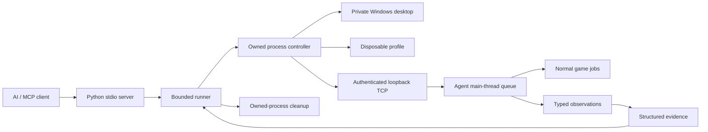

# Architecture and extensibility / 原理与可拓展性

[中文 README](../README.md) · [English README](../README.en.md) · [First test](GETTING_STARTED.md)

## Components / 组件

| Component | Responsibility / 职责 |
|---|---|
| `src/rimprobe/server.py` | Standard MCP stdio, strict typed inputs / 标准 MCP 与严格输入 |
| `plans.py`, `schema.py`, `contracts.py` | Bounded plans and recipe validation / 有界计划与配方校验 |
| `runner.py` | One owned test lifecycle, polling and evidence / 单轮状态机、轮询与证据 |
| `controller.py`, `profiles.py` | Game identity, disposable profile, actual load order / 版本、独立配置与排序核对 |
| `background.py` | Private desktop, process handles and Job Object / 私有桌面与进程归属 |
| `agent/BridgeRuntime.cs` | Authenticated loopback transport and main-thread dispatch / 会话认证与主线程调度 |
| `agent/Scenario*.cs` | Generic actions, typed observations and failure evidence / 通用操作、观察与异常 |
| `agent/RegisteredTests.cs` | Trusted compiled test registration / 可信编译包注册 |

Network workers handle bounded messages; they do not access game objects. The game main thread consumes queued commands and advances test state machines. The controller owns process handles created for its worker, not arbitrary existing game PIDs. A Job Object ties worker lifetime to its controller.

通信线程只处理有界消息，游戏对象在主线程访问。测试通过短次 Pump 推进，不在主线程循环等待；控制器只管理自己创建的进程句柄，不能接管玩家现有游戏。

## Profiles and trust / 配置与信任边界

The default `inherit` mode reads an enabled-mod list, preserves relative order and DLC entries, then writes a disposable copy with explicit additions. Actual loading is compared against that request. Normal player saves/configuration are not edited. Per-mod settings are not cloned by default: tests needing settings must declare a controlled fixture, not assume player defaults were reproduced.

默认只读继承排序，在一次性副本增补并核对实际加载。不复制存档，也不默认复制所有 Mod 设置。没有本轮环境变量时 Agent 不开启测试监听/补丁。会话 token 不写入公开 descriptor；监听仅限 loopback，协议具有版本和长度边界。

There is no remote eval, C# compilation/upload, arbitrary method name or reflection path. Compiled test packs are explicitly installed mod code with normal in-process privileges; they are trusted extensions, not sandboxes. Private desktops prevent system-input automation but do not establish zero performance impact or compatibility with every third-party mod.

## Test semantics / 测试语义

Fixtures precede actions, measurements and assertions. Initial conditions may be prepared; expected results must come from the normal behavior under test. An accepted job is a request, not an effect pass. Measurements bind actual numeric baselines; assertions compare actual values or deltas. No assertions means no functional pass.

准备对象可以走显式 fixture，但不能把预期效果直接写成成功。建筑需真实搬运/施工，技能需正常施放再观察效果。Root.Update 的采样不保证每 Tick 都观察，UI/Repaint 也不能单靠游戏 Tick 证明。

The suite's business result and runner's overall result are separate. Startup errors, runtime errors, incomplete coverage, load-order mismatch or cleanup failures can prevent an overall pass. `primary_failure` preserves the original exception; `cleanup_failures` preserves independent cleanup faults. Valid test-pack checks are copied before Dispose, so cleanup mutation cannot rewrite them.

`controller_finished` means the worker thread ended. Cleanup success requires both `cleanup_status=succeeded` and `owned_process_exit_verified=true`; `cleanup_complete` is a legacy attempt-finished alias. Retained original owned sessions can receive bounded cleanup retries through cancel_run, never via arbitrary PID attachment.

## Three extension levels / 三层扩展

### 1. Compose an existing plan / 组合原语

Use actual Def identifiers, run-local aliases, normal actions and independent observations. Start with `examples/plans/`. A new standard AbilityDef or item does not require new C# logic just because its name is new.

Limits include 24 steps, a 24 KiB normalized input, bounded Tick/wall-clock budgets and a 40 KB suite-evidence budget. Read current capabilities/schema before composing; unsupported fields cannot be invented.

### 2. Add a mechanism / 新增机制

When a real implementation needs an unrepresented mechanism:

1. Define the normal entry point and an observable, falsifiable effect using real version-specific APIs.
2. Add strict typed Python schema and validation, plus the corresponding Agent allowlist and main-thread implementation.
3. Bound work, evidence and waits; identify cleanup ownership before issuing actions.
4. Add meaningful negative/fault tests and compile against genuine separate 1.6/1.7 references.
5. Record offline versus real-reference compilation versus live evidence separately, then update docs/capabilities.

按机制增加能力，不能逐物品硬编码，也不能为方便测试开放任意私有字段/方法执行。新观察若仅证明计数增长，不能冒称已验证真实绘制或业务效果。

### 3. Install a trusted test pack / 可信测试包

Implement `IProbeTest`: `Start(Map)` prepares a disposable fixture, `Pump()` performs bounded normal actions/observations on the game main thread, `Report` exposes scope/phase/checks, and `Dispose()` cleans up on success, failure or cancellation. Register an explicit key with `RegisteredProbeTests.Register`. Without a RimProbe session, registration remains inert.

Use `query_tests` to discover registered keys and `registered_test` to select one. The MCP interface cannot upload, compile or select arbitrary methods. See [the detailed contract](registered-test-packs.md); `testpacks/StarMoon` is an optional real integration example requiring a separately supplied target mod.

## Reproducibility and publication / 复现与发布

Game/engine/Agent fingerprints, load order and profile integrity already exist. Complete target/test-pack loaded-artifact provenance, baseline error comparisons and historical MCP indexing remain planned; do not claim those features today. Current runs are ephemeral control sessions, while their evidence files remain on local disk.

The repository excludes game/Harmony/target-mod binaries, build caches, environment files and raw run data. Historical validation summaries are included, but their local `runs/` links are not downloadable evidence bundles. Archived development notes retain original machine paths as historical context. Public setup examples must be adapted to the reader's machine.

当前源码预览没有稳定 Release。二进制分发需先确定对应构建的版本身份、限定真机验证范围及可复查打包清单；不能把离线编译通过当成稳定运行保证。
